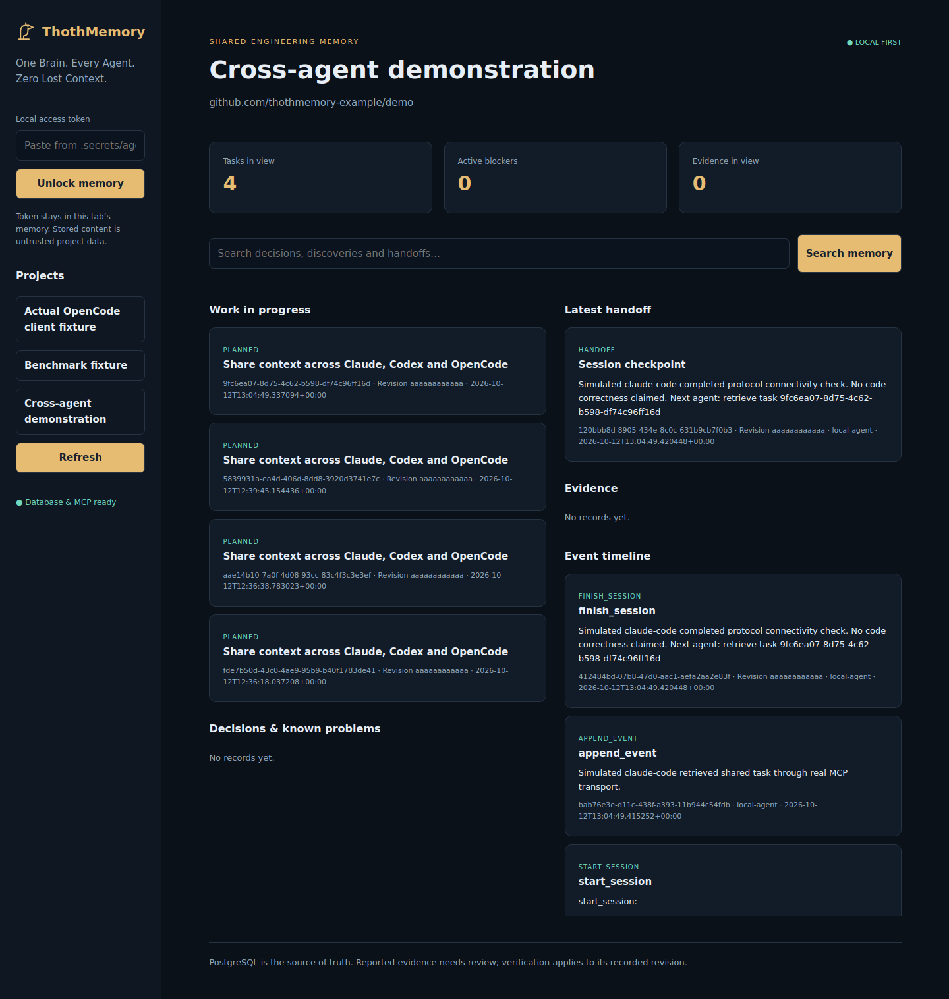
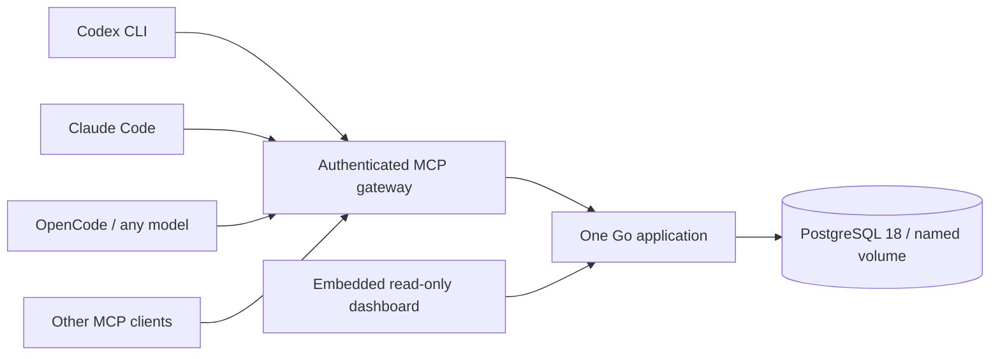

<div align="center">

# ThothMemory

**One Brain. Every Agent. Zero Lost Context.**

Local-first shared engineering memory for **Codex CLI · Claude Code · OpenCode**.

[](https://github.com/Lord1Egypt/ThothMemory/actions/workflows/ci.yml)
[](LICENSE)
[](https://hub.docker.com/r/lord1egypt/thoth-memory)

</div>

Your next agent should know where the work stopped, what was attempted, and which
claims have evidence. ThothMemory keeps that context in your own PostgreSQL database
and exposes it through standard MCP. No LLM API key, paid service, model dependency,
or local embedding model is required by ThothMemory.

Switch between agents, recover a crashed terminal, or return after several days.
Load a short briefing, compare current HEAD, read the last handoff, and resume with
an auditable record of tasks, decisions, problems and test evidence.



*Screenshot from the running application with explicitly simulated agent sessions.*

## Install in one step

Install and start Docker Desktop with Linux containers (Windows/WSL2), or Docker
Engine with Compose (Linux). Clone this repository or download its source archive.
No Go, PostgreSQL installation, Node.js runtime or model key is needed.

**Windows — double-click `start-thothmemory.cmd`**, or run:

```powershell
.\start-thothmemory.cmd
```

**Linux / WSL2:**

```sh
./setup.sh
```

Setup pulls the released image, extracts the native CLI, generates secure local
credentials, starts PostgreSQL, applies migrations, checks real MCP initialization
and tool discovery, and opens **http://127.0.0.1:7319** where a browser launcher is
available. Unlock the dashboard with `.secrets/agent_token` (or the read-only token).
Running setup again preserves data and credentials. Review any image upgrade and
[back up first](docs/BACKUP_RESTORE.md).

After initial configuration, the minimal deployment command is:

```sh
docker compose up -d
```

Named volumes persist memory across restarts and container recreation. Do not use
`docker compose down -v` unless you intend to remove memory and have a tested backup.

## Connect your agents

From the installation directory:

```sh
./bin/thothmemory connect all --dir /path/to/your/project
./bin/thothmemory instructions --dir /path/to/your/project
```

On Windows use `.\bin\thothmemory.exe` and a Windows project path. The connector
detects installed CLIs, shows target files, asks consent, backs up changes, preserves
other servers, avoids duplicate registration and verifies the backend handshake.
Client-specific credentials stay in protected files; configs contain only a stdio
bridge command and config path. Restart clients and accept their project trust prompts.

| Client | Register | Configuration |
|---|---|---|
| Codex CLI | `thothmemory connect codex` | `.codex/config.toml`; project must be trusted |
| Claude Code | `thothmemory connect claude` | `.mcp.json`; approve server on launch |
| OpenCode | `thothmemory connect opencode` | `opencode.json` / `.jsonc`; detects legacy or V2 layout |

Use `--scope user` for global configuration, `--dir PATH` for project configuration,
and `--yes` only after reviewing targets when automating. Existing conflicting
ThothMemory registrations require review; they are never silently replaced.
Install OpenCode using [its official installation instructions](https://opencode.ai/docs/).
The integration works independently of its selected model/inference provider.

**MCP registration alone does not enforce memory updates.** Install the shared
instructions, and optionally enable supported lifecycle adapters:

```sh
./bin/thothmemory hooks claude --dir /path/to/project
./bin/thothmemory hooks codex --dir /path/to/project
./bin/thothmemory hooks opencode --dir /path/to/project
./bin/thothmemory doctor
```

Codex hooks require `--enable hooks`. Command hooks target Linux/WSL; native Windows
uses the shared instructions. The OpenCode plugin loads context, records lifecycle
metadata and requests a checkpoint before compaction; it does not invent a semantic
handoff. See [the shared protocol](docs/AGENT_MEMORY_PROTOCOL.md) and
[actual client validation](docs/VALIDATION.md) for supported versions and limitations.

For clients preferring direct HTTP, register `http://127.0.0.1:7319/mcp` with a bearer
token read from your environment or secure file. Never commit a raw token. Codex
supports `--bearer-token-env-var`; the default bridge avoids shell environment setup.

## What it remembers

- Stable repository identities, branches/revisions and durable agent sessions.
- Planned, active, blocked, implemented, committed, tested, verified and released tasks.
- Decisions, observations, known issues, attempted resolutions and concise handoffs.
- Evidence source, locator, full revision, outcome, artifact digest and reporter.
- Append-only history, supersession, transactional writes and optimistic revisions.
- Full-text, keyword and exact lookup with project/task/agent/time/evidence filters.
- Project-scoped read/write credentials and short context briefings with provenance.

A reported test result remains reported evidence. A task can become **verified** only
with owner-attested passing test/CI evidence for its exact revision and task. Attestation
records owner review; ThothMemory does not independently execute or validate tests.
Older evidence is flagged stale when a different current revision is supplied.

## One shared workflow

1. Claude resolves the repository, loads context and starts a session at HEAD.
2. It records a task, a decision and revision-specific evidence, then writes a handoff.
3. Codex loads that handoff, compares HEAD and updates the task with its expected revision.
4. OpenCode reads the same project, checkpoints progress and records the next handoff.
5. Claude retrieves the updated state without starting the investigation over.

Try the repeatable, model-free demonstration:

```sh
./bin/thothmemory demo
```

This uses four independent MCP connections: Claude → Codex → OpenCode → Claude.
The actor identities are simulated; the server, PostgreSQL, protocol and persistence
are real. No demonstration output is represented as a production correctness claim.

## Architecture



Official Go MCP SDK + pgx + deterministic SQL migrations. PostgreSQL is the source
of truth. No Redis, vector database, message broker or frontend container. The
runtime container is non-root with a read-only filesystem and no Docker socket.

## Security defaults

Only the loopback app port is published. PostgreSQL is internal. Random file-based
credentials, project allowlists, read-only tokens, strict Host/Origin validation,
parameterized SQL, input limits, immutable historical records and separate migration
and runtime DB privileges are included. Stored memory is always untrusted data.
Each project has a bounded event budget; service logs rotate.

This is a local shared-owner trust domain. Do not expose it to the public internet.
Read [security design and limits](docs/SECURITY.md) before changing access boundaries.

## Backup, move and restore

```sh
./bin/thothmemory backup backups/memory.dump
./bin/thothmemory restore backups/memory.dump --confirm
```

Restore verifies the archive/checksum, backs up the current database and restores to
a **new database**. It never implicitly overwrites existing memory. Review the result,
then activate the printed database in `.env`. [Recovery and moving PCs](docs/BACKUP_RESTORE.md).

## Development and validation

```sh
./scripts/test-integration.sh   # disposable PostgreSQL, real MCP, race detector
./scripts/check.sh             # formatting, module integrity, vet and tests
./setup.sh --build             # build and deploy from source using Docker
```

Go 1.26.9+ is needed only for native development. CI executes PostgreSQL integration,
MCP/security/concurrency tests, vulnerability analysis, image build and deployment,
restart persistence, and backup/restore validation. Release images are smoke-tested
on amd64 and arm64 before `latest` promotion. [Validation](docs/VALIDATION.md) and
[measured performance](docs/PERFORMANCE.md) report actual results and their limits.

## Documentation

[Architecture](docs/ARCHITECTURE.md) · [Database model](docs/DATABASE_SCHEMA.md) ·
[MCP contracts](docs/MCP_API.md) · [Agent protocol](docs/AGENT_MEMORY_PROTOCOL.md) ·
[Security](docs/SECURITY.md) · [Backup/restore](docs/BACKUP_RESTORE.md) ·
[Troubleshooting](docs/TROUBLESHOOTING.md) · [Decisions](docs/DECISIONS.md) ·
[Dependency licenses](docs/DEPENDENCIES.md)

## Limits and roadmap

- Abrupt process termination may skip hooks; incremental checkpoints are essential.
- Agent-reported facts and labels are not independent verification or authentication.
- The initial service is local-only and single-owner; scoped tokens are explicit boundaries.
- OpenCode's experimental lifecycle API can change; V2 and legacy diagnostics differ.
- Search uses bounded offset pagination; no embeddings or cross-project automatic inference.
- Backups require Docker and are not encrypted by the application.

Future work: optional local embeddings/pgvector, richer evidence import, archive/export
workflows and additional MCP clients. Remote multi-user hosting needs its own security
architecture. Contributions are welcome; see [CONTRIBUTING.md](CONTRIBUTING.md).

**License:** [MIT](LICENSE). Dependencies retain their own notices.

**Image:** [lord1egypt/thoth-memory](https://hub.docker.com/r/lord1egypt/thoth-memory).
