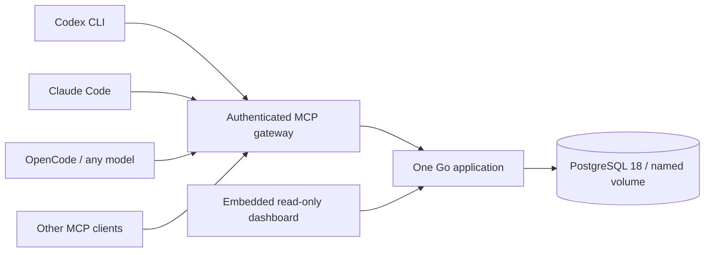

<div align="center">

# ThothMemory

**One Brain. Every Agent. Zero Lost Context.**

Local-first shared engineering memory for **Codex CLI · Claude Code · OpenCode**.

[](https://github.com/Lord1Egypt/ThothMemory/actions/workflows/ci.yml)
[](https://github.com/Lord1Egypt/ThothMemory/releases/latest)
[](LICENSE)
[](https://hub.docker.com/r/lord1egypt/thoth-memory)

</div>

Your next agent should know where the work stopped, what was attempted, and which
claims have evidence. ThothMemory keeps that context in your own database (PostgreSQL, MariaDB or
SQLite, by edition) and exposes it through standard MCP. No LLM API key, paid service, model dependency,
or local embedding model is required by ThothMemory.

Switch between agents, recover a crashed terminal, or return after several days.
Load a short briefing, compare current HEAD, read the last handoff, and resume with
an auditable record of tasks, decisions, problems and test evidence.


*Screenshot from the running application with explicitly simulated agent sessions.*

> Pre-production patch candidate: see the [2026-10-12 audit](docs/audits/PREPRODUCTION-AUDIT.md).
> Published deployment remains 0.1.1. Candidate fixes are not a live upgrade.
> OpenCode 1.17.13 legacy is tested; normal V2 runtime rejects V2 keys.
> Audit correction: published 0.1.1 Docker arm64 contains an x86-64 binary. Its
> standalone arm64 binary is correct. The container fix awaits an approved patch release.

## Install in one step

Install and start Docker Desktop with Linux containers (Windows/WSL2), or Docker
Engine with Compose (Linux). Clone this repository or download its source archive.
No Go, PostgreSQL installation, Node.js runtime or model key is needed.

**Windows — double-click `start-thothmemory.cmd`**, or run:

```powershell
.\start-thothmemory.cmd
```

**Linux / WSL2:**

```sh
./setup.sh
```

Setup pulls the released image, extracts the native CLI, generates secure local
credentials, starts PostgreSQL, applies migrations, checks real MCP initialization
and tool discovery, and opens **http://127.0.0.1:7319** where a browser launcher is
available. Unlock the dashboard with `.secrets/agent_token` (or the read-only token).
Running setup again preserves data and credentials. Review any image upgrade and
[back up first](docs/BACKUP_RESTORE.md).

After initial configuration, the minimal deployment command is:

```sh
docker compose up -d
```

Named volumes persist memory across restarts and container recreation. Do not use
`docker compose down -v` unless you intend to remove memory and have a tested backup.

## Choose an edition

| | **Full** | **Mini** | **UltraLite** |
|---|---|---|---|
| Storage | PostgreSQL 18 | MariaDB 11.4 (inside one container) | SQLite (one file) |
| Needs | Docker | Docker-compatible CLI (built for ThothDock on Android) | **nothing**: one native executable |
| Agent transport | HTTP MCP via a stdio bridge | same | **direct MCP stdio** (no server) |
| Dashboard | yes | yes | **no, headless by design** |
| Network listener | `127.0.0.1:7319` | `127.0.0.1:7319` | **none** |

Details, measurements and differences: [editions](docs/EDITIONS.md),
[benchmarks](docs/BENCHMARKS.md). All three enforce the same memory rules and the same
[agent protocol](THOTHMEMORY_AGENT_PROTOCOL.md).

## Connect Your AI Agents — Automatic Persistent Memory

**Try it in two minutes (UltraLite, no Docker):** tell one agent a small idea, close it,
open another agent, and get the same idea back.

```sh
thothmemory-ultralite init                       # data directory, credentials, database
cd your-project                                  # a Git checkout with an `origin` remote
thothmemory-ultralite connect all                # shows the files it will edit, asks consent
thothmemory-ultralite instructions               # protocol file + a short reference block
thothmemory-ultralite hooks claude               # optional: automatic session capture (Linux/macOS/WSL)
```

Restart your agents, approve their trust prompts, then say to the first agent:
*"Maybe we can make a SQLite version for PocketClaw."* It records an **idea** (status
PROPOSED, never a decision). Close it, start a different agent in the same folder and ask
*"What ideas do we have for this project?"* You can read the same record yourself:

```sh
thothmemory-ultralite search PROJECT_ID PocketClaw     # PROJECT_ID from: thothmemory-ultralite projects
```

This exact flow was run with real Codex and real Claude Code; see
[the evidence](docs/audits/evidence/real-client-handoff.md) and
[`scripts/real-client-handoff.sh`](scripts/real-client-handoff.sh).

### 1. Install and initialize

**UltraLite** (download `thothmemory-ultralite-<os>-<arch>` from a release, or build it with
`CGO_ENABLED=0 go build -o thothmemory-ultralite ./cmd/thothmemory-ultralite`):

```sh
# Linux / macOS / WSL
install -m 0755 thothmemory-ultralite ~/.local/bin/ && thothmemory-ultralite init
```
```powershell
# Windows PowerShell, no administrator
$bin = "$env:LOCALAPPDATA\Programs\ThothMemory"; New-Item -ItemType Directory -Force $bin | Out-Null
Copy-Item .\thothmemory-ultralite.exe $bin; & "$bin\thothmemory-ultralite.exe" init
```

Data lives in `~/.local/share/thothmemory` (Linux), `~/Library/Application Support/ThothMemory`
(macOS) or `%LOCALAPPDATA%\ThothMemory` (Windows); override with `--data DIR` or `THOTH_HOME`.
[UltraLite guide](docs/ULTRALITE.md).

**Full:** `./setup.sh` (Linux/WSL2) or `.\start-thothmemory.cmd` (Windows); the native CLI is
`./bin/thothmemory`. See [Install in one step](#install-in-one-step).

**Mini (ThothDock / any Docker-compatible CLI, no Compose needed):**

```sh
scripts/thothmini.sh install --image YOUR_MINI_IMAGE@sha256:DIGEST --port 7319 --restart
scripts/thothmini.sh clients      # puts the native client and per-agent configs in ~/.thothmemory-mini
```

Mini images are not published yet; build `Dockerfile.mini` and push it to a registry your
engine can pull from. [Mini guide](docs/MINI.md).

Below, `TM` is your CLI: `thothmemory-ultralite`, `./bin/thothmemory`, or
`~/.thothmemory-mini/thothmemory-mini`. For Full and Mini add `--config client.json` (Mini:
`--config ~/.thothmemory-mini/client.json`) to `connect`, `hooks`, `capture` and `doctor`.

### 2. Register your agents

```sh
TM connect all                       # Claude Code, Codex and OpenCode that are installed
TM connect claude --scope user       # one client, global instead of this project
TM connect codex --dir /path/to/project --yes   # --yes = you reviewed the targets
```

Every run lists the files it will change and asks first, preserves all other settings,
backs up what it changes, and refuses to overwrite a different existing `thothmemory` entry.

| Client | Project scope (default) | User scope (`--scope user`) | After registering |
|---|---|---|---|
| Claude Code | `.mcp.json` | `~/.claude.json` (`$CLAUDE_CONFIG_DIR/.claude.json`) | Project servers show *Pending approval*: run `claude` and approve once |
| Codex CLI | `.codex/config.toml` | `~/.codex/config.toml` (`$CODEX_HOME`) | Codex ignores project config until the folder is trusted; user scope needs no trust |
| OpenCode | `opencode.json` / `.jsonc` | `~/.config/opencode/opencode.json` | Works with the legacy schema; OpenCode V2 files are refused unless `--allow-unverified-v2` |
| Other MCP clients | stdio command: `thothmemory-ultralite mcp-stdio --data DIR --token-file DIR/.secrets/agent_token` (UltraLite) or `TM bridge --config client.json` (Full, Mini) | | See [MCP quickstart](docs/MCP_QUICKSTART.md) |

### 3. Turn on automatic memory (with your consent)

A prompt file alone cannot guarantee anything, so there are two layers:

```sh
TM instructions                 # writes THOTHMEMORY_AGENT_PROTOCOL.md; adds a short block to AGENTS.md and CLAUDE.md
TM hooks claude                 # SessionStart, UserPromptSubmit, PreCompact, Stop, SessionEnd
TM hooks codex                  # same events through .codex/hooks.json
TM hooks opencode               # plugin: session context, compaction checkpoint, idle/error metadata
TM capture status               # off | metadata (default) | prompts
TM capture set prompts --yes    # opt in: also store your request text as notes
```

`instructions` never overwrites your files: it adds one replaceable block
(`<!-- thothmemory:begin … -->`) and installs the protocol file next to them. Command hooks
are Linux, macOS and WSL only; on native Windows use `instructions` and the agent's own MCP
writes (the OpenCode plugin works everywhere).

What is **proven** to be captured, by whom:

| Event | Mechanism | Verified with |
|---|---|---|
| Project registered from the canonical `origin`, session started or resumed, context printed | `SessionStart` hook | Real Claude Code; hook command strings for Codex |
| Your request stored as a note (opt-in, secrets skipped, duplicates suppressed) | `UserPromptSubmit` hook | Real Claude Code |
| Compaction marker on the same session | `PreCompact` hook | Hook command only; not triggered in a real session yet |
| Idle (rate-limited), error, session end | `Stop`, `SessionEnd` | Real Claude Code |
| Ideas, notes, decisions, issues, tasks, test results, checkpoints, handoffs | The agent, through MCP tools, following the protocol | **Real Codex and real Claude Code** |

Not proven: real Codex firing hooks (it needs hook review in its UI and none arrived in our
runs), and real-model OpenCode sessions. Hooks cannot infer meaning; **semantic memory comes
from the agent writing through MCP**, which is exactly what the protocol asks. Details,
privacy rules and limits: [automatic memory](docs/AUTOMATIC_MEMORY.md).

### 4. Verify the connection, then verify memory really works

```sh
TM doctor                       # files, permissions, database integrity, a live MCP session
claude mcp list                 # Claude Code: expect "✔ Connected"
codex mcp list                  # Codex: lists thothmemory with its stdio command
opencode mcp list               # OpenCode: expect "✓ thothmemory connected"
```

Then prove a write and a read. Ask any connected agent: *"Record a note that the
build needs Go 1.26, then search memory for 'Go 1.26'."* and check it yourself (UltraLite):

```sh
thothmemory-ultralite projects                       # UltraLite: every project and its next action
thothmemory-ultralite search PROJECT_ID "Go 1.26"
```

Full and Mini: open the dashboard at `http://127.0.0.1:7319` and search, or ask a second agent.

### 5. Retrieve earlier conversations, tasks, ideas and handoffs

Ask the agent, or read it directly (UltraLite CLI; the same data is in the Full/Mini dashboard):

| You want | Ask the agent | UltraLite CLI |
|---|---|---|
| Where did we stop? | "Load the latest handoff." | `thothmemory-ultralite brief PROJECT_ID --head $(git rev-parse HEAD)` |
| An idea from last week | "Search memory for 'PocketClaw'." | `thothmemory-ultralite search PROJECT_ID PocketClaw` |
| Open work | "List active and blocked tasks." | `thothmemory-ultralite tasks PROJECT_ID --state blocked` |
| What happened | "Show recent activity." | `thothmemory-ultralite timeline PROJECT_ID` |

`stale` in a briefing means that record was made at a different commit than your checkout.

### 6. Switch between agents and keep the project state

Nothing to export or paste. Every agent opens the same memory for the same repository
(identified by `origin`, not the folder name). Before leaving an agent, ask it to
"checkpoint and finish with a handoff" (or rely on the hooks); open the next agent in the
same folder and it starts from the briefing. See [agent handoff](docs/AGENT_HANDOFF.md).

**Walkthrough: Claude Code → Codex → OpenCode on one project.**

```sh
cd ~/code/demo-app && git remote -v                 # has an origin
thothmemory-ultralite init && thothmemory-ultralite connect all --yes
thothmemory-ultralite instructions --yes && thothmemory-ultralite hooks claude --yes
```
1. **Claude Code:** `claude`, approve the server, say *"Add a backup command. Maybe we could also support Arabic project names."* Per the protocol it should record the task, the idea, its test result and checkpoints. Close it.
2. **Check:** `thothmemory-ultralite projects` then `thothmemory-ultralite brief PROJECT_ID`.
3. **Codex:** `codex` in the same folder: *"Continue from the last handoff and add a note: Windows data lives in LOCALAPPDATA."* Expect it to report the idea and unfinished work from memory, then record the note.
4. **OpenCode:** `opencode` in the same folder: *"What did the other agents do, and what is left?"* Expect an answer drawn from the handoffs and notes.

Automated version of this walkthrough with simulated agents:
`go test ./tests -run TestAutomaticMemoryEndToEnd -v`. Steps 1 and 3 with real models:
`scripts/real-client-handoff.sh`. Real-model OpenCode was **not** exercised; its connection was.

### 7. Troubleshooting

| Symptom | Check |
|---|---|
| Agent has no `memory_*` tools | `TM doctor`; restart the agent; Claude: approve the project server; Codex: trust the folder or use `--scope user` |
| `claude mcp list` shows *Pending approval* | Run `claude` interactively once and approve the server |
| `unauthorized: token is not in the current policy` | The credential was revoked or `--data` points elsewhere; `TM permissions` and check the path in your client config |
| Agent says it saved but nothing is there | UltraLite: `thothmemory-ultralite search`/`projects`, or the dashboard; agents must call `memory_record_*`; read `TM capture status` and [automatic memory](docs/AUTOMATIC_MEMORY.md) |
| *queued for retry* messages | The database was busy or the service down; replay with `TM capture retry` |
| `credential` refusal when writing | Intended: the text looked like a secret; rewrite without the value |
| Hooks do nothing | Hooks are Linux/macOS/WSL only; Codex needs `--enable hooks` and hook review; `TM capture status` must not be `off` |
| `no UltraLite database at …` | Run `thothmemory-ultralite init`, or pass the right `--data` |
| Mini does not start on a phone | First start can take minutes; `scripts/thothmini.sh logs`; see [Mini](docs/MINI.md) |

### 8. Disconnect or stop recording

```sh
TM capture set off              # hooks stop recording and printing; stored memory is untouched
claude mcp remove thothmemory   # unregister (Codex: codex mcp remove thothmemory)
```
OpenCode: delete the `thothmemory` entry from `opencode.json`. Remove hooks by deleting the
`lifecycle` entries from `.claude/settings.json` / `.codex/hooks.json` or
`.opencode/plugins/thothmemory.js`. Configuration backups made by `connect` sit beside the
files as `*.thoth-backup-*`. Agents may still use MCP tools unless you unregister.

### 9. Back up and restore

```sh
thothmemory-ultralite backup                    # online snapshot, integrity-checked, SHA-256 sidecar
thothmemory-ultralite restore FILE --confirm    # refuses while an agent is connected; keeps the old file
./bin/thothmemory backup backups/memory.dump    # Full; restore FILE --confirm creates a NEW database
scripts/thothmini.sh backup && scripts/thothmini.sh restore FILE   # Mini; restores into a new database
```

Move a project between editions with `TM export PROJECT_ID > p.json` and `TM import < p.json`
([portability](docs/PORTABILITY.md)).

## What it remembers

- Stable repository identities, branches/revisions and durable agent sessions.
- Planned, active, blocked, implemented, committed, tested, verified and released tasks.
- Decisions, observations, known issues, attempted resolutions and concise handoffs.
- Evidence source, locator, full revision, outcome, artifact digest and reporter.
- Append-only history, supersession, transactional writes and optimistic revisions.
- Full-text, keyword and exact lookup with project/task/agent/time/evidence filters.
- Project-scoped read/write credentials and short context briefings with provenance.

A reported test result remains reported evidence. A task can become **verified** only
with owner-attested passing test/CI evidence for its exact revision and task. Attestation
records owner review; ThothMemory does not independently execute or validate tests.
Older evidence is flagged stale when a different current revision is supplied.

## One shared workflow

1. Claude resolves the repository, loads context and starts a session at HEAD.
2. It records a task, a decision and revision-specific evidence, then writes a handoff.
3. Codex loads that handoff, compares HEAD and updates the task with its expected revision.
4. OpenCode reads the same project, checkpoints progress and records the next handoff.
5. Claude retrieves the updated state without starting the investigation over.

Try the repeatable, model-free demonstration:

```sh
./bin/thothmemory demo
```

This uses four independent MCP connections: Claude → Codex → OpenCode → Claude.
The actor identities are simulated; the server, PostgreSQL, protocol and persistence
are real. No demonstration output is represented as a production correctness claim.

## Architecture



Official Go MCP SDK + pgx + deterministic SQL migrations. PostgreSQL is the source
of truth. No Redis, vector database, message broker or frontend container. The
runtime container is non-root with a read-only filesystem and no Docker socket.

## Security defaults

Only the loopback app port is published. PostgreSQL is internal. Random file-based
credentials, project allowlists, read-only tokens, strict Host/Origin validation,
parameterized SQL, input limits, immutable historical records and separate migration
and runtime DB privileges are included. Stored memory is always untrusted data.
Each project has a bounded event budget; service logs rotate.

This is a local shared-owner trust domain. Do not expose it to the public internet.
Read [security design and limits](docs/SECURITY.md) before changing access boundaries.

## Backup, move and restore

```sh
./bin/thothmemory backup backups/memory.dump
./bin/thothmemory restore backups/memory.dump --confirm
```

Restore verifies the archive/checksum, backs up the current database and restores to
a **new database**. It never implicitly overwrites existing memory. Review the result,
then activate the printed database in `.env`. [Recovery and moving PCs](docs/BACKUP_RESTORE.md).

## Development and validation

```sh
./scripts/test-integration.sh   # disposable PostgreSQL, real MCP, race detector
./scripts/check.sh             # formatting, module integrity, vet and tests
./setup.sh --build             # build and deploy from source using Docker
```

Go 1.26.9+ is needed only for native development. CI executes PostgreSQL integration,
MCP/security/concurrency tests, vulnerability analysis, image build and deployment,
restart persistence, and backup/restore validation. Release images are smoke-tested
on amd64 and arm64 before `latest` promotion. [Validation](docs/VALIDATION.md) and
[measured performance](docs/PERFORMANCE.md) report actual results and their limits.

## Documentation

[Editions](docs/EDITIONS.md) · [MCP quickstart](docs/MCP_QUICKSTART.md) ·
[Automatic memory](docs/AUTOMATIC_MEMORY.md) · [Agent handoff](docs/AGENT_HANDOFF.md) ·
[Agent protocol](THOTHMEMORY_AGENT_PROTOCOL.md) · [UltraLite](docs/ULTRALITE.md) ·
[Mini](docs/MINI.md) · [Portability](docs/PORTABILITY.md) · [Benchmarks](docs/BENCHMARKS.md) ·
[Android gate](docs/ANDROID_GATE.md) · [PocketClaw contract](docs/POCKETCLAW_INTEGRATION.md) ·
[Release readiness](docs/RELEASE_READINESS.md) · [Architecture](docs/ARCHITECTURE.md) · [Database model](docs/DATABASE_SCHEMA.md) ·
[MCP contracts](docs/MCP_API.md) · [Agent protocol](docs/AGENT_MEMORY_PROTOCOL.md) ·
[Security](docs/SECURITY.md) · [Backup/restore](docs/BACKUP_RESTORE.md) ·
[Troubleshooting](docs/TROUBLESHOOTING.md) · [Decisions](docs/DECISIONS.md) ·
[Dependency licenses](docs/DEPENDENCIES.md)

## Limits and roadmap

- Abrupt process termination may skip hooks; incremental checkpoints are essential.
- Agent-reported facts and labels are not independent verification or authentication.
- The initial service is local-only and single-owner; scoped tokens are explicit boundaries.
- OpenCode's experimental lifecycle API can change; V2 and legacy diagnostics differ.
- Search uses bounded offset pagination; no embeddings or cross-project automatic inference.
- Backups require Docker and are not encrypted by the application.

Future work: optional local embeddings/pgvector, richer evidence import, archive/export
workflows and additional MCP clients. Remote multi-user hosting needs its own security
architecture. Contributions are welcome; see [CONTRIBUTING.md](CONTRIBUTING.md).

**License:** [MIT](LICENSE). Dependencies retain their own notices.

**Image:** [lord1egypt/thoth-memory](https://hub.docker.com/r/lord1egypt/thoth-memory).

## Release evidence

See the [delivery report](docs/DELIVERY.md) for published digests, successful workflow
runs, actual measurements and known limits, and the [executed demonstration](docs/DEMONSTRATION.md)
for public-image installation and recovery results.
