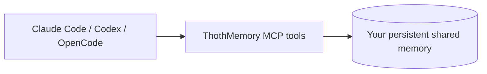

# ThothMemory — One Memory for Every AI Agent

**Persistent, local-first memory for Claude Code, Codex, OpenCode and other MCP-compatible agents.**

Your AI agent can continue where another agent stopped. Keep project notes,
ideas, decisions, tasks, evidence and handoffs in your own database.

[](https://github.com/Lord1Egypt/ThothMemory/actions/workflows/ci.yml)
[](https://github.com/Lord1Egypt/ThothMemory/releases/latest)
[](LICENSE)
[](docs/PLATFORMS.md)

**Start with UltraLite: one executable, one SQLite database, no Docker.**
ThothMemory needs no model API key; your AI client keeps its own model settings.
Memory works offline, though your assistant may need a connection.

**What is it?** ThothMemory is a local, MCP-compatible project memory for AI coding agents. It stores
notes, ideas, tasks, decisions, evidence, progress and handoffs in a database on your machine, so the
next session or a different agent can continue the work instead of starting from nothing.

[Beginner tutorial](docs/GETTING_STARTED.md) · [العربية](docs/README_AR.md)



## Choose your edition

| Edition | Database | Docker | Web UI | Recommended for |
|---|---|---|---|---|
| **UltraLite** | SQLite | **No** | No | Individuals and desktops; easiest setup |
| **Full** | PostgreSQL 18 | Yes | Yes | Persistent service and complete dashboard |
| **Mini** | MariaDB 11.4 | Docker-compatible engine | Yes | ThothDock and compact container environments |

All editions share memory tools and a portable project format. Mini uses fewer
database processes than Full; UltraLite is the smallest option.

[Download v0.2.3](https://github.com/Lord1Egypt/ThothMemory/releases/tag/v0.2.3):
[UltraLite Windows](https://github.com/Lord1Egypt/ThothMemory/releases/download/v0.2.3/thothmemory-ultralite-windows-amd64.exe) ·
[Linux amd64](https://github.com/Lord1Egypt/ThothMemory/releases/download/v0.2.3/thothmemory-ultralite-linux-amd64) ·
[Linux ARM64](https://github.com/Lord1Egypt/ThothMemory/releases/download/v0.2.3/thothmemory-ultralite-linux-arm64).
[Full Docker Hub](https://hub.docker.com/r/lord1egypt/thoth-memory) ·
[Mini Docker Hub](https://hub.docker.com/r/lord1egypt/thoth-memory-mini).
[Platform status](docs/PLATFORMS.md) labels experimental macOS/Android builds.

## Get started in under five minutes — UltraLite

Install your chosen AI assistant's CLI first. No Go compiler, database server or
administrator privileges needed. Keep the executable in a permanent location;
agents launch it by its full path.

### Windows

Open the v0.2.3 release. Download
**thothmemory-ultralite-windows-amd64.exe** and **SHA256SUMS**. Open PowerShell
in the download folder. Compare `Get-FileHash .\thothmemory-ultralite-windows-amd64.exe -Algorithm SHA256`
with its entry in SHA256SUMS. Then:

```powershell
$bin = "$env:LOCALAPPDATA\Programs\ThothMemory"
New-Item -ItemType Directory -Force $bin | Out-Null
Copy-Item .\thothmemory-ultralite-windows-amd64.exe "$bin\thothmemory-ultralite.exe"
& "$bin\thothmemory-ultralite.exe" init
# Replace this placeholder with your own Git project's folder.
Set-Location C:\path\to\your-project
& "$bin\thothmemory-ultralite.exe" connect all
& "$bin\thothmemory-ultralite.exe" instructions
& "$bin\thothmemory-ultralite.exe" doctor
```

No PATH setup is needed. Native Windows uses MCP writes and instructions;
command hooks require Linux/macOS/WSL.

### Linux amd64

Download **thothmemory-ultralite-linux-amd64** and SHA256SUMS. From that folder:

```sh
sha256sum thothmemory-ultralite-linux-amd64  # compare with SHA256SUMS
mkdir -p ~/.local/bin
install -m 0755 thothmemory-ultralite-linux-amd64 ~/.local/bin/thothmemory-ultralite
~/.local/bin/thothmemory-ultralite init
cd /path/to/your-project
~/.local/bin/thothmemory-ultralite connect all
~/.local/bin/thothmemory-ultralite instructions
~/.local/bin/thothmemory-ultralite doctor
```

### Linux ARM64

Download **thothmemory-ultralite-linux-arm64**. Replace the install command above
with the following; initialization and connection commands are identical:

```sh
mkdir -p ~/.local/bin
install -m 0755 thothmemory-ultralite-linux-arm64 ~/.local/bin/thothmemory-ultralite
```

The full path works even if `~/.local/bin` is not on PATH. Both platforms need a
Git project with an `origin` remote for automatic project identification.

## Connect an AI assistant

MCP is the standard that lets an assistant call ThothMemory's memory tools.
`connect all` registers whichever supported clients are installed. Choose one:

```sh
~/.local/bin/thothmemory-ultralite connect claude
~/.local/bin/thothmemory-ultralite connect codex
~/.local/bin/thothmemory-ultralite connect opencode
```

On Windows use `& "$bin\thothmemory-ultralite.exe"` instead of the Linux path.
Default scope is **this project**, in the current folder. Add `--scope user` for
all projects. Run `instructions` in each project or `instructions --scope user`.
Changes are shown for consent; unrelated settings and text are preserved.

Restart the assistant and approve its normal project/MCP trust prompt. Verify
with `claude mcp list`, `codex mcp list` or `opencode mcp list`.
[Configuration files and scopes](docs/MCP_QUICKSTART.md).

## Turn on persistent memory

**Connect** makes tools available. **Instructions** teach the model to save
meaningful information. **Supported hooks** load context and record lifecycle
metadata automatically. Installation alone does not guarantee that an agent
saves every important detail; hooks cannot understand technical decisions.

Optional Claude capture on Linux/WSL:

```sh
~/.local/bin/thothmemory-ultralite hooks claude
~/.local/bin/thothmemory-ultralite capture status
~/.local/bin/thothmemory-ultralite capture set metadata
# Optional bounded user-request capture, with explicit consent:
~/.local/bin/thothmemory-ultralite capture set prompts --yes
```

Claude's SessionStart, UserPromptSubmit, PreCompact, Stop and SessionEnd were
observed. **Codex semantic writes work; hook capture remains unverified.** Use
MCP + instructions + checkpoints. Optional `hooks codex` also requires normal
folder trust and `/hooks` review. OpenCode's connection and plugin fixtures
passed; real-model behavior is unverified. Optional plugin: `hooks opencode`.
[Capture details](docs/AUTOMATIC_MEMORY.md).

## Your first memory

Tell a connected agent: **“Remember that we might add SQLite support to PocketClaw.”**
Ask it to save an **IDEA / PROPOSED**, not an approved decision. Close the agent,
start another in the same project, and ask: **“What ideas were recorded for PocketClaw?”**

[Real Codex→Claude retrieval was demonstrated](docs/audits/evidence/real-client-handoff.md)
with no shared chat. OpenCode can connect to the same memory; the third
real-model step remains unverified. Confirm persistence yourself:

```sh
~/.local/bin/thothmemory-ultralite projects
~/.local/bin/thothmemory-ultralite search PROJECT_ID PocketClaw
```

Replace PROJECT_ID with the returned ID. An agent saying “saved” is not proof.
To resume, ask the next agent to load project context and the latest handoff,
compare Git revision, and continue unfinished work. [Handoffs](docs/AGENT_HANDOFF.md).

## What is saved?

Ideas, notes, requirements, tasks, decisions, issues, failed attempts, progress
checkpoints, reported test evidence and handoffs. Evidence retains its source
and revision; an agent's report is not independent verification. Hooks record
supported lifecycle metadata and optional bounded requests. They do not collect
full transcripts, every tool result or unrelated conversations. A sudden kill
can skip the final callback; existing checkpoints help the next agent recover.

## Full — PostgreSQL and browser dashboard

Install Docker Desktop with Linux containers on Windows, or Docker Engine plus
Compose on Linux. Download and extract **thothmemory-v0.2.3-source.tar.gz** from
the release. In its extracted folder:

```sh
./setup.sh
./bin/thothmemory connect all --dir /path/to/your-project
./bin/thothmemory instructions --dir /path/to/your-project
```

Windows: run `.\start-thothmemory.cmd`, then use `.\bin\thothmemory.exe`.
Setup pulls the published image, creates credentials, **creates this installation's own
empty data volume** (named in `.env`), starts PostgreSQL and checks MCP. Open
**http://127.0.0.1:7319**, unlock with `.secrets/read_token`, and keep those files
private. The volume persists memory across `docker compose stop` / `start`.

> **Three different jobs, three different commands.** *Fresh install* is `./setup.sh` in a
> new empty folder (it never reuses an existing volume). *Upgrade an existing installation*
> is deliberate: back up, then `./bin/thothmemory adopt-volume NAME --confirm NAME`, then
> setup ([docs/UPGRADE.md](docs/UPGRADE.md)). *Restore a backup* goes into a new database
> ([docs/BACKUP_RESTORE.md](docs/BACKUP_RESTORE.md)). A bare `docker compose up` without
> setup fails before creating anything.
[Full walkthrough](docs/GETTING_STARTED.md#full-with-docker).

## Mini — ThothDock and compact containers

> **Which Mini?** Use **Mini 0.1.3** from [release v0.2.3](https://github.com/Lord1Egypt/ThothMemory/releases/tag/v0.2.3)
> (`lord1egypt/thoth-memory-mini@sha256:7280e3008759075d9b1d577bde47740cbe9a55a64df56aae359f813531f3b1cc`). It passed the complete backup, verified restore and recovery
> lifecycle (26 gates, including 20 consecutive restarts) and 11 MCP gates on linux/amd64 and on linux/arm64 under QEMU
> (emulated). Mini 0.1.2 (same code) additionally passed the physical Samsung SM-A165F gates
> ([evidence](docs/ANDROID_GATE.md)); **the 0.1.3 digest itself has not been tested on the phone.** Not verified:
> endurance, battery, background-kill behavior (Android stays a preview). Mini 0.1.0 (v0.2.0) is superseded: its backup could
> fail with `TLS/SSL error: certificate is not yet valid`. Before upgrading, copy your `thothmemory-mini-data` volume.

Download **thothmini.sh** and **MINI_IMAGE_DIGEST.txt** from the main release.
In ThothTerm, start ThothDock first. Then:

```sh
sh ./thothmini.sh install --image "$(cat MINI_IMAGE_DIGEST.txt)" --port 7319
sh ./thothmini.sh clients
~/.thothmemory-mini/thothmemory-mini connect all --config ~/.thothmemory-mini/client.json
sh ./thothmini.sh doctor
```

No Compose needed. Data and credentials live in `thothmemory-mini-data`;
uninstall keeps that volume. The distribution uses the tested glibc variant.
The published Mini 0.1.2 digest passed the physical Samsung gates (see docs/ANDROID_GATE.md).
No battery or multi-hour background guarantee. [Mini tutorial](docs/MINI.md).

## Privacy, permissions and data location

ThothMemory does not upload your database. **An AI client may send retrieved
context to its model provider**, according to its own settings. UltraLite stores
data in `~/.local/share/thothmemory` on Linux, `%LOCALAPPDATA%\ThothMemory` on
Windows; `--data DIR` selects another location. Full/Mini use persistent volumes.
Each agent has a scoped credential. Memory is untrusted data, never permission.
Secret screening rejects many credential patterns but is not a guarantee.
Never deliberately store secrets. Prompt capture is opt-in; your OS account
remains the trust boundary. [Security details](docs/SECURITY.md).

## Backup, restore and updates

```sh
# UltraLite: online backup; keep its checksum sidecar too.
~/.local/bin/thothmemory-ultralite backup
~/.local/bin/thothmemory-ultralite restore /path/to/backup.db --confirm
# Full, from its install folder with Docker running:
./bin/thothmemory backup /path/to/backup.dump
./bin/thothmemory restore /path/to/backup.dump --confirm
# Mini:
sh ./thothmini.sh backup /path/to/backups
sh ./thothmini.sh restore /path/to/backup.sql
```

UltraLite restore refuses active clients and keeps the old database. Full/Mini
restore into another database; review activation separately. Keep independent
backups and test restore. Update UltraLite by replacing only its executable.
For Full/Mini, rehearse upgrades on a restored copy first. [Safe upgrades](docs/UPGRADE.md)
· [Portable export/import](docs/PORTABILITY.md).

## Troubleshooting

| Symptom | Next step |
|---|---|
| UltraLite is missing from an older release | v0.1.2 is Full-only; use the unified v0.2.3 release linked above |
| Command not found | Use the full executable path shown above; check CPU architecture |
| Client not installed | Install its CLI on PATH, then rerun `connect` |
| Tools absent | Restart client, approve trust, run `doctor` and client `mcp list` |
| “Saved” but no search result | Check project ID/data directory; ask agent to perform the actual MCP write and report errors |
| Hooks do nothing | Windows command hooks unsupported; Codex hooks unverified; check `capture status` |
| Memory temporarily unavailable | `capture pending`, then `capture retry`; agent MCP writes need explicit retry with the same operation ID |
| Interrupted session | Ask the next agent to read unfinished sessions and the last checkpoint |
| Mini not ready | `sh ./thothmini.sh logs`; check port, process budget and glibc image |

`capture set off` disables capture while preserving memory. Never use volume
deletion or `docker compose down -v` as routine maintenance.

## Advanced documentation

[Getting Started](docs/GETTING_STARTED.md) · [العربية](docs/README_AR.md) ·
[MCP](docs/MCP_QUICKSTART.md) · [Automatic memory](docs/AUTOMATIC_MEMORY.md) ·
[Agent protocol](THOTHMEMORY_AGENT_PROTOCOL.md) · [Architecture](docs/ARCHITECTURE.md) ·
[API](docs/MCP_API.md) · [Schema/migrations](docs/DATABASE_SCHEMA.md) ·
[Benchmarks](docs/BENCHMARKS.md) · [Android evidence](docs/ANDROID_GATE.md) ·
[Platforms](docs/PLATFORMS.md) · [Development](AGENTS.md).
