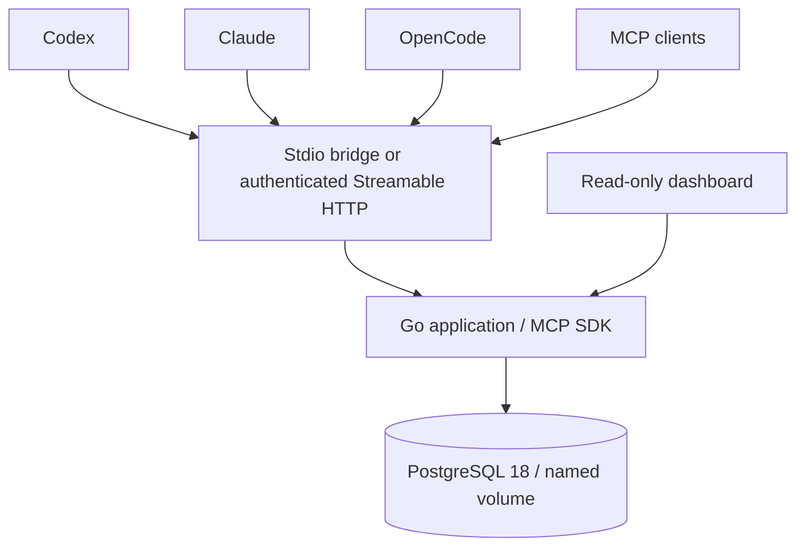

# Architecture and acceptance contract

ThothMemory is a local, single-owner service with explicitly scoped agent credentials.
One Go executable serves Streamable HTTP MCP and an embedded, read-only dashboard.
PostgreSQL 18 is authoritative. pgx provides a bounded pool; the official MCP Go SDK
owns protocol framing, initialization, tool schemas and HTTP sessions. No LLM or
embedding service is required. Stdio is a client-side authenticated bridge to HTTP.

## Data and trust
Projects have UUIDs and unique canonical repository identities, never folder names.
Local repositories need an explicit `local:<uuid>` identity. Sessions retain branch
and HEAD checkpoints. Tasks use revisions, dependencies, claim ownership, and states
planned / active / blocked / implemented / committed / tested / verified / released.
Events and memory records are append-only. Decisions are superseded by linked records.
Evidence retains source kind, locator, revision, artifact digest, outcome and reporter.
An MCP client cannot attest its own evidence: owner CLI attestation is a distinct
privileged operation. Verified tasks require owner-attested passing evidence for the
exact task and revision. An attestation records trust; it does not independently
execute tests or prove that supplied output is authentic. Releases additionally
require owner-attested release evidence. All content is untrusted data.

## Transactions and retries
Mutations lock a project operation key before checking its payload hash. Replays
return the original response; reuse with a different payload is rejected. Task
updates compare expected revision, change state, and append history atomically.
Composite foreign keys prevent cross-project evidence and session associations.
Versioned embedded SQL migrations take an advisory lock, validate checksums, and
commit atomically. Runtime uses a non-superuser role with DML permissions; migrations
use a separate owner connection. Historical tables reject UPDATE/DELETE.

## Security boundary
Loopback published port only; PostgreSQL has no host port. Random file-based tokens,
constant-time checks, per-token read/write scopes and project allowlists, strict
Host/Origin checks, body limits, query timeouts, parameterized SQL, CSP, and escaped
DOM rendering. No agent SQL, shell, filesystem, admin or credential tools. CLI
backup/restore invokes fixed Docker/pg_dump commands under explicit human control.
Container is non-root, read-only, drops capabilities, and has no Docker socket.
Initial credentials explicitly authorize all local projects; restricted credentials
can limit projects. This is a local shared-owner trust domain, not public SaaS.

## Acceptance gates
Real SDK client handshake/discovery/calls; three-agent/four-session handoff; FTS; stale writes,
duplicates and conflicting idempotency; invalid/cross-project evidence; immutable
history; unauthorized/read-only requests; migrations/restart; backup/restore;
clean Compose setup; actual client registration/connectivity in isolated homes;
amd64 and emulated arm64 smoke tests; measured resources. Publication is gated on
successful checks. Windows validation requires a Windows host and is reported
separately if unavailable. No prompt or hook guarantees a final write after SIGKILL;
checkpoint frequently and surface interrupted sessions at resume.

## Sources checked 2026-10-12
- https://go.sdk.modelcontextprotocol.io/
- https://github.com/modelcontextprotocol/go-sdk
- https://www.postgresql.org/docs/current/textsearch.html
- https://www.postgresql.org/docs/current/app-pgdump.html
- https://developers.openai.com/codex/mcp/
- https://developers.openai.com/codex/config-reference/
- https://code.claude.com/docs/en/mcp
- https://code.claude.com/docs/en/hooks
- https://docs.docker.com/compose/how-tos/use-secrets/
- https://docs.docker.com/build/ci/github-actions/attestations/
- https://docs.github.com/en/actions/reference/security/secure-use

## Pre-production patch

The [2026-10-12 audit](audits/PREPRODUCTION-AUDIT.md) adds NFC/simple/literal search,
bounded checkpoint recovery, explicit Windows file ACLs and owner policy management.
No new runtime process or dependency version is required. Existing project IDs,
credentials, evidence and revisions survive the additive migration. OpenCode normal
V2 runtime remains unverified/unsupported in the tested client; legacy is accepted.
