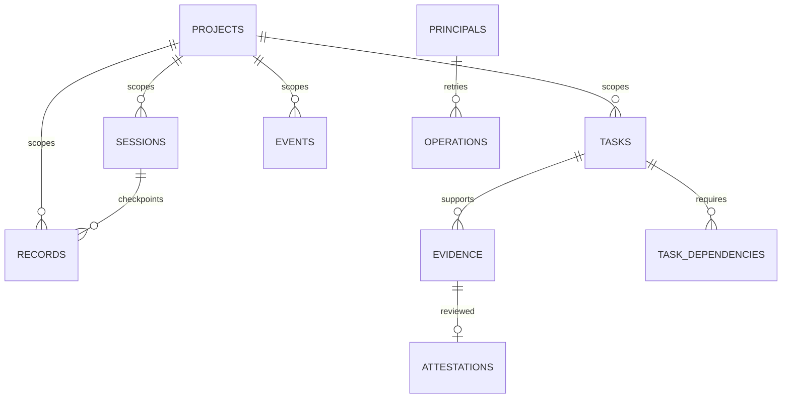

# PostgreSQL model

| Table | Purpose / constraints |
|---|---|
| principals | Authenticated local credential identities; tokens stay outside DB |
| projects | UUID, unique canonical repository, event counter and budget |
| agents | Reported client identities |
| sessions | Project, principal, agent, branch, full revision, lifecycle, optimistic revision |
| tasks | State, current Git revision, optimistic revision, claim principal and expiry |
| task_dependencies | Composite project FK for both tasks; no self dependency |
| events | Immutable timeline of every transactional mutation |
| records | Immutable decisions, issues, observations and handoffs; supersession FK |
| evidence | Immutable source, locator, revision, artifact digest, outcome, reporter |
| attestations | Immutable owner statement linked to evidence |
| operations | Project + principal + operation ID, payload hash and original response |
| schema_migrations | Versioned SQL checksum and application timestamp |
| memory_search (view) | Normalized searchable projection across records/events/tasks/evidence |

Task states: planned, active, blocked, implemented, committed, tested, verified,
released. Each state records a distinct claim. Committed/tested/verified/released
require a full SHA; tested additionally needs reported passing test/CI evidence;
verified requires owner-attested passing test/CI evidence for the same task and SHA;
released requires owner-attested release evidence. A state does not imply tests
were independently run by ThothMemory.

Composite foreign keys prevent project mixing. Supersession is one replacement per
record; replacing that replacement forms a preserved chain. Dependencies may only
refer to existing tasks when a new task is created, preventing dependency cycles.
History tables have rejecting triggers; runtime cannot insert owner attestations.
JSONB holds idempotent response snapshots and transactional event details; core entities are typed columns.
Generated English and simple tsvector columns have GIN indexes; project/state/time indexes bound queries. Migration 005 adds NFC-normalized text and simple vectors without changing immutable history. Literal substring search complements full-text retrieval.

Mutations reserve an event budget slot, lock idempotency, compare revisions, update
state and append history in one transaction. Failed operations roll back the budget
reservation too. Same operation/payload returns the original result; changing payload
with the same operation ID fails. Project creation uses unique repository identity as
its natural idempotency key. Append-only event IDs are ordered by timestamp + UUID.
