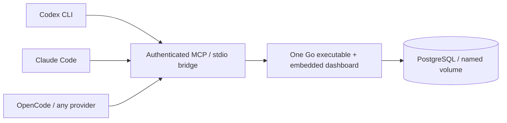

# ThothMemory 0.1.1 — delivery report

Historical 0.1.1 report. Current patch audit: [PREPRODUCTION-AUDIT.md](audits/PREPRODUCTION-AUDIT.md).

**Audit correction:** published 0.1.1 Docker arm64 contains an x86-64 ELF executable.
Earlier arm64 smoke output did not verify instruction-set architecture and is not
compatibility evidence. Standalone arm64 release binary is correct. See the
[pre-production audit](audits/PREPRODUCTION-AUDIT.md); published tags remain immutable.


Validated and published 2026-10-12 under the authenticated GitHub account Lord1Egypt
and independently verified Docker Hub account lord1egypt.

## Published artifacts

- [Public source repository](https://github.com/Lord1Egypt/ThothMemory)
- [Public GitHub release 0.1.1](https://github.com/Lord1Egypt/ThothMemory/releases/tag/v0.1.1)
- [Docker Hub image and description](https://hub.docker.com/r/lord1egypt/thoth-memory)
- Tags: `lord1egypt/thoth-memory:0.1.1` and `latest`.
- [Native binaries, SHA256SUMS and IMAGE_DIGEST.txt](https://github.com/Lord1Egypt/ThothMemory/releases/tag/v0.1.1): Linux/Windows, amd64/arm64. All four binary checksums verified after download. Unauthenticated public release download returned HTTP 200.
- License: MIT. Compatible dependency notices are in `third_party/` and `/licenses` inside the image.

```text
OCI index:   sha256:0edd6990289b12099a5c4d44525e9e5bf03fc52934ba09dfb43f293ed4bf9e63
linux/amd64: sha256:38bd538ab05de073b001e88a4530c2d1f7e9b6b570907f62a0af5e3074b4a2d4
linux/arm64: sha256:9280b0624dbf7b65340b392785ad1b4706c7c83c7017d2c45cea5fff78833c87
```

Anonymous pull by index digest passed. Both platform attestations were retrieved:
SPDX SBOM and SLSA provenance. amd64 compressed layers total 10,330,734 bytes;
local Docker image inspection reported Size=38,760,940 bytes. Docker image-store
accounting and compressed transfer size are different measurements.

## Architecture

Go 1.26.9, official MCP Go SDK 1.8.0, pgx 5.11.0, PostgreSQL 18.6. One non-root
application container, PostgreSQL and a transient migration service. Embedded
read-only dashboard; Streamable HTTP MCP plus authenticated stdio bridge.



Normalized projects/repositories, principals, agents, sessions, tasks/dependencies,
evidence/attestations, append-only events, superseding memory records and idempotent
operations. Four deterministic checksum-checked migrations. Task/session revisions
protect concurrent updates; transaction rollback preserves history consistency.
Verified/released states require matching owner-attested evidence; an MCP report
cannot attest itself. Owner attestation records review, not independent execution.

23 schema-validated `memory_` tools cover projects, context, sessions/checkpoints,
tasks/claims, events, decisions/issues/observations, evidence/tests, search and handoffs.
See [tool contracts](MCP_API.md) and [schema](DATABASE_SCHEMA.md).

Loopback publication, internal-only PostgreSQL, random file credentials, project
read/write scopes, least-privilege runtime role, strict Host/Origin checks, parameterized
SQL, bounded input/context, escaped dashboard rendering and untrusted-memory guidance.
No arbitrary shell, filesystem, SQL, secret or administration MCP tools. No Docker
socket mount. Container is non-root, read-only and drops capabilities.

## Implementation and commits

Source: `cmd/thothmemory`, `internal/{cli,gateway,store,web}`, `migrations`, `scripts`,
`tests`, `examples`, `docs`, `third_party`, `.github/workflows`.

- `1e44f31`: complete memory core, dashboard, bootstrap, integrations, tests and docs.
- `d32ca4d`: preserve quoted/inline Codex TOML and detect OpenCode schema markers.
- `76176f7`: resolve active backup database through Compose; regression test; release source for v0.1.1.
- `327d969`: containerd publication runner and retries guarded by successful release validation.

## Executed gates

| Gate | Result / evidence |
|---|---|
| Source CI, PostgreSQL integration, race tests, Windows CLI/config | [Passed](https://github.com/Lord1Egypt/ThothMemory/actions/runs/38256317254) |
| Tagged source validation and native release artifacts | [Passed](https://github.com/Lord1Egypt/ThothMemory/actions/runs/38256353527) |
| Final publication workflow CI | [Passed](https://github.com/Lord1Egypt/ThothMemory/actions/runs/38257187573) |
| OCI build, SBOM/provenance, published architecture tests, clean deployment and promotion | [Passed](https://github.com/Lord1Egypt/ThothMemory/actions/runs/38257187961) |
| Three-agent handoff | Claude → Codex → OpenCode → Claude; independent real MCP connections |
| Concurrency/idempotency | One conflicting revision winner; stale updates and changed retries rejected |
| Evidence/security | Unattested and wrong-revision verification, unauthorized/read-only writes, cross-project associations, hostile Host/Origin rejected |
| Migrations | Clean/repeated/001 upgrade and checksum-corruption rejection passed |
| Recovery | App/DB restart, archive integrity, recovery backup, new-database restore and activated .env backup sentinel passed |
| Genuine installed clients | Codex health call; Claude Connected; OpenCode Connected and authenticated create/write/read plus lifecycle plugin event |
| Published installers | Linux/WSL and native Windows PowerShell 5.1 passed setup/repeat/MCP/backup/restore |
| Browser | Actual Chromium dashboard/search/mobile validation; actual screenshot in README |
| Vulnerabilities | govulncheck and configured Trivy high/critical fixable gate passed |

The first publication attempt failed because GitHub's classic image store could not
retain both platforms under one index digest. The documented containerd store fixed
this runner issue; all gates were rerun successfully. The unpublished 0.1.0 tag remains
immutable after its release was cancelled to fix active-database backup selection.
No 0.1.0 release or version/latest image was promoted.

See [VALIDATION.md](VALIDATION.md) and [DEMONSTRATION.md](DEMONSTRATION.md) for scope,
commands and observed output. No normal user agent profiles were modified by tests.

## Actual resource measurements

Intel i7-9750H, WSL2/Docker Desktop, 12 allocated logical CPUs, about 12.7 GiB Docker
memory. Warm local measurements: initialization median 1.429 ms; context 4.947 ms;
event write 6.225 ms; search 7.307 ms. Eight concurrent writers/100 events: 387.325 ms.
Idle single sample: app 9.359 MiB, PostgreSQL 61.32 MiB, each 0.00% CPU. App restart
to readiness: 864.973 ms. Fresh candidate setup: 33 seconds with cached base layers.
These are observed local samples, not scale guarantees. [Method and p95](PERFORMANCE.md).

## One-click deployment

Windows: `start-thothmemory.cmd`. Linux/WSL2: `./setup.sh`.
After secure initialization: `docker compose up -d`.
Dashboard: http://127.0.0.1:7319. MCP: http://127.0.0.1:7319/mcp.
Unlock with `.secrets/agent_token`, or use the read-only credential.

```sh
./bin/thothmemory connect all --dir /path/to/project
./bin/thothmemory instructions --dir /path/to/project
./bin/thothmemory doctor
./bin/thothmemory backup backups/memory.dump
./bin/thothmemory restore backups/memory.dump --confirm
```

`connect codex`, `connect claude` and `connect opencode` are available separately.
Use `--scope user` for global registration; target files are shown and consent is
required before writing. Windows uses `.\bin\thothmemory.exe`. Client trust prompts
remain active. Optional `hooks CLIENT` adapters complement shared instructions.
Connecting MCP alone does not enforce memory updates.

Repository About, Issues, Discussions and private vulnerability reporting configured.
Topics: agent-memory, ai-agents, ai-automation, claude-code, codex, developer-tools,
docker, docker-compose, local-first, mcp, model-context-protocol, open-source, opencode,
persistent-memory, postgresql, shared-memory. No invented homepage.

## Known limitations and next work

- Local single-owner trust domain; public remote hosting/TLS/multi-user tenancy deferred.
- Owner attestation records human review; the platform does not independently execute tests.
- Hooks cannot guarantee writes after abrupt termination; incremental checkpoints are necessary.
- Native command hooks target Linux/WSL; native Windows uses shared instructions.
- Installed OpenCode legacy runtime has genuine connectivity/writes/plugin validation. V2 registration/schema preservation is tested; the full V2 runtime/provider/plugin-catalog matrix remains unexecuted.
- Windows ARM64 binaries are cross-compiled and checksum-verified; native Windows testing used amd64. Container arm64 used emulation.
- Optional embeddings/pgvector, richer dashboards and retention administration are future enhancements. Event storage has a documented project budget; no silent history deletion.
