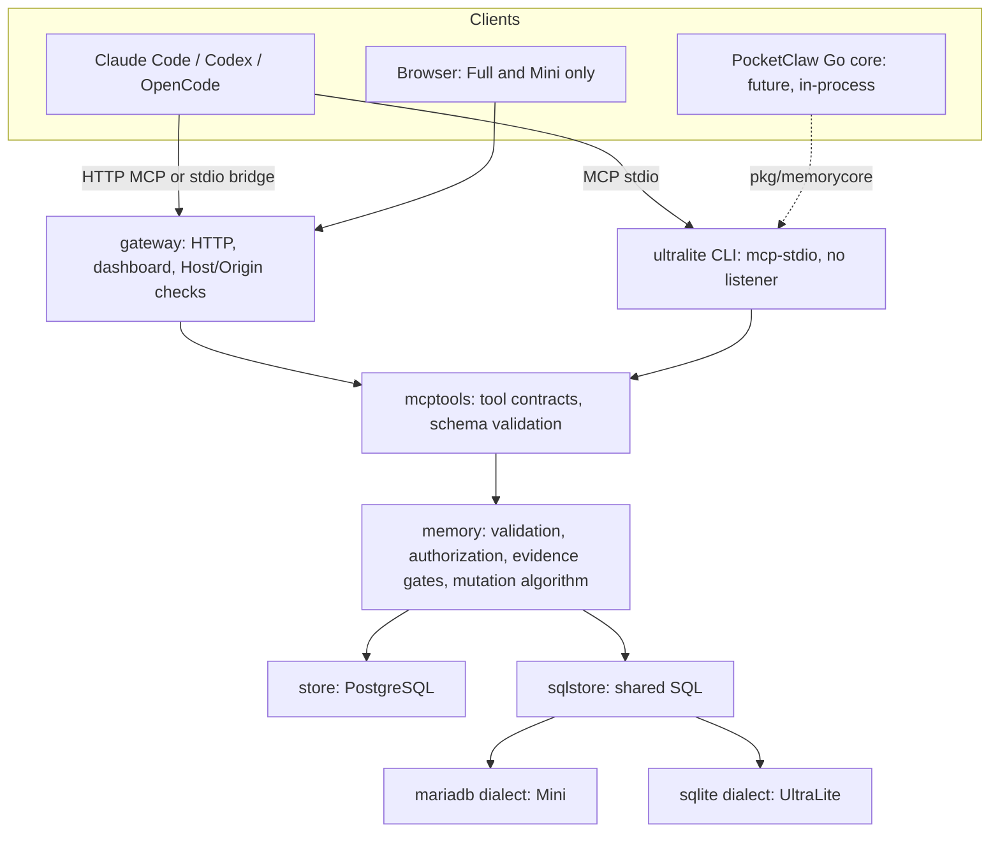

# ThothMemory editions

ThothMemory ships as three editions built from one shared core. Every edition
enforces the same memory rules; they differ only in storage, packaging and
interfaces. Status labels below distinguish what was **verified** (executed in
this repository's tests or on a named platform), **implemented** (code exists,
not independently executed on the target), and **not available**.

| | Full | Mini | UltraLite |
|---|---|---|---|
| Storage | PostgreSQL 18 | MariaDB 11.4 LTS (private, in-container) | SQLite 3.53 (one file) |
| Runs as | Docker Compose (app + database) | One container (service supervises mariadbd) | One native executable, no service |
| Primary target | Desktop, server, WSL2 | ThothDock on Android ARM64 | Laptops and desktops without Docker |
| Agent transport | HTTP MCP; stdio bridge | HTTP MCP on 127.0.0.1; stdio bridge | **MCP stdio only** (client launches it) |
| Web dashboard | Yes | Yes (same embedded UI) | **No** (headless by design) |
| Network listener | 127.0.0.1:7319 | 127.0.0.1:7319 inside ThothDock | **None** |
| Search | English stemming, simple tokens, NFC literal substring | NFC literal substring per term, light English suffix folding | Same as Mini |
| Owner tools | CLI via `docker compose run migrate` | CLI via `docker exec` | Native CLI |
| Backup | `pg_dump` custom format + SHA-256, restore into a new database | `mariadb-dump --single-transaction` + SHA-256, restore into a new database, explicit activation | `VACUUM INTO` online snapshot, integrity-checked + SHA-256, restore keeps the previous file |
| Portable export/import | Yes | Yes | Yes |
| Size unpacked (download, gzip) | 28.7 MB app + 304.8 MB `postgres:18-alpine` (≈130 MB) | 60.3 MB Alpine image (23.8 MB); 128.7 MB glibc image (62.6 MB) | 12.5–13.6 MB executable (5.9 MB) |

See [benchmarks](BENCHMARKS.md) for measured memory, CPU, latency and growth.

## Shared guarantees (all editions)

Verified by one contract suite that runs against each backend
(`internal/contract`, `tests/contract_test.go`, `tests/sqlite_test.go`):

- Projects keyed by canonical repository identity, never folder names.
- Authenticated principals with per-project allowlists and read-only credentials;
  write tools hidden from read credentials and refused again in the core.
- Optimistic task and session revisions; claims owned by the authenticated
  principal with expiry.
- Idempotent operations: the same operation ID and payload replays the original
  result; a changed payload is a conflict.
- Every mutation is one transaction: budget slot, state change, event and
  operation record commit together or not at all.
- Append-only events, records, evidence, attestations, operations and imports,
  enforced by database triggers.
- Evidence gates: `tested` needs passing test/CI evidence for the same task and
  full revision; `verified` and `released` also need owner attestation, which no
  MCP client can perform.
- Supersession keeps the replaced record; context shows only current decisions.
- Composite foreign keys forbid cross-project links.
- Identical response shapes for every read tool and dashboard view
  (`TestContractShapeParity` compares all three).

## Architecture

| Package | Role |
|---|---|
| `internal/memory` | Domain: identities, input bounds, authorization, evidence requirements, the mutation algorithm, next-action rules |
| `internal/mcptools` | MCP tool contracts, JSON-schema validation, one MCP server per principal; no HTTP |
| `internal/gateway` | HTTP MCP, dashboard API, Host/Origin/body limits (Full, Mini) |
| `internal/store` | PostgreSQL backend (Full); SQL unchanged from 0.1.x |
| `internal/sqlstore` | SQL shared by MariaDB and SQLite, plus a small dialect |
| `internal/mariadb`, `internal/mini` | Mini: connection, migrations, bootstrap, supervisor, backup |
| `internal/sqlite`, `internal/ultralite` | UltraLite: connection, migrations, online backup, CLI and stdio runtime |
| `internal/portable` | Backend-neutral export/import |
| `pkg/memorycore` | Public in-process API for embedding (see [PocketClaw contract](POCKETCLAW_INTEGRATION.md)) |

## Edition boundaries

- **Full** keeps the PostgreSQL deployment, HTTP MCP and dashboard of 0.1.x.
- **Mini** is one container. The Go service starts a private `mariadbd` with TCP
  networking disabled, reached through an abstract Unix socket, and serves MCP
  and the dashboard on loopback. See [Mini](MINI.md).
- **UltraLite** is headless: CLI plus MCP stdio. Its build is checked in CI to
  exclude the HTTP gateway, the dashboard assets and both server backends. See
  [UltraLite](ULTRALITE.md).

## Known differences between editions

| Behaviour | Full | Mini / UltraLite |
|---|---|---|
| English stemming ("migrations" ↔ "migrate") | PostgreSQL dictionary | Removes one common suffix from ASCII words of five or more letters |
| Multi-word query | Full-text AND, plus literal phrase | Every term as a substring, or the literal phrase |
| Search ranking values | `ts_rank` sum | Integer score (match, phrase, phrase in title); order is deterministic in both |
| Search operators (`"quoted"`, `-term`, `or`) | `websearch_to_tsquery` syntax | Not supported; quotes and parentheses are stripped |
| Lowercasing for search | PostgreSQL `lower()` (locale) | Go Unicode lowercase |
| Project name ordering | Database locale | Unicode collation (Mini), ASCII case-insensitive (UltraLite) |
| Search cost | GIN indexes for tokens, scan for literal substrings | Per-project scan; see growth measurements |
